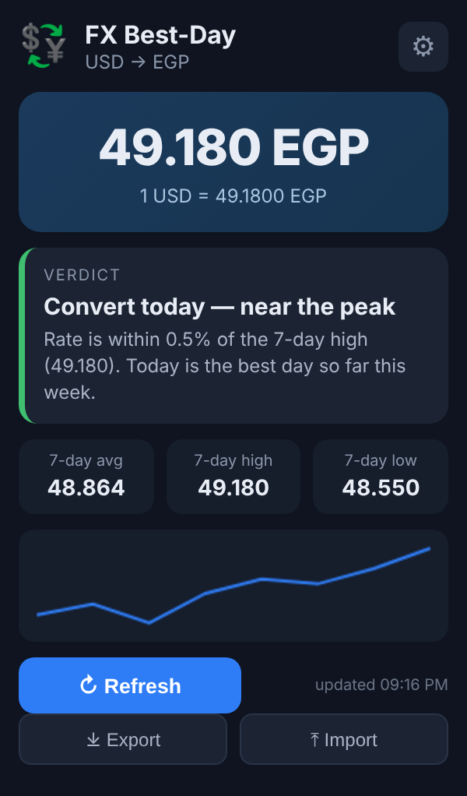
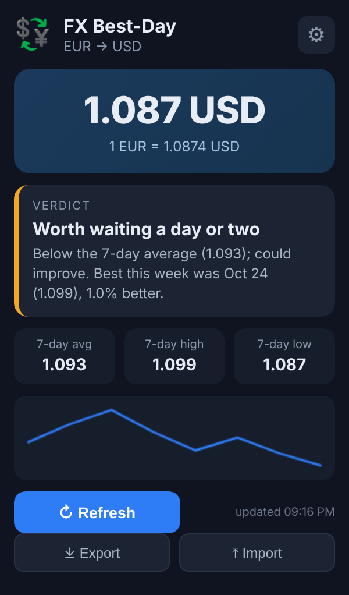
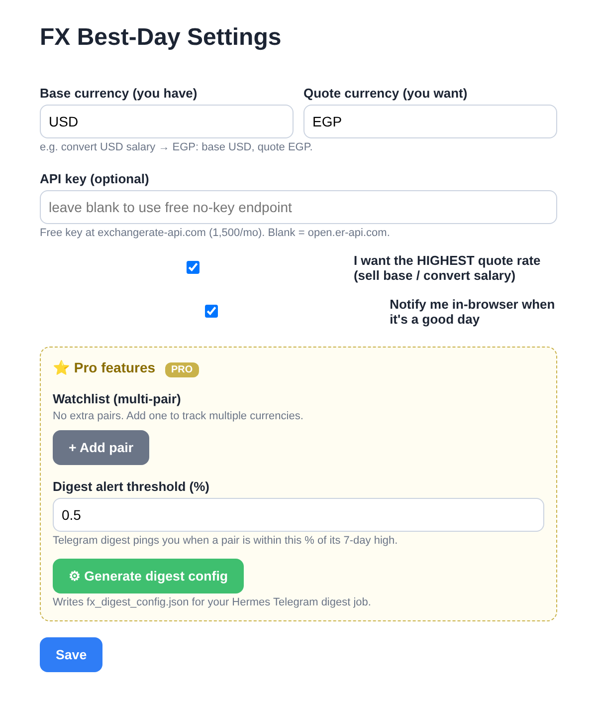

<div align="center">


# FX Best-Day

**Know the single best day this week to convert your money: salary, freelance or remittance.**


</div>

## Screenshots

<table>
  <tr>
    <td align="center"></td>
    <td align="center"></td>
    <td align="center"></td>
  </tr>
  <tr>
    <td align="center"><b>Convert today</b><br/><sub>USD → EGP near its 7-day peak</sub></td>
    <td align="center"><b>Wait</b><br/><sub>EUR → USD below average, best day shown</sub></td>
    <td align="center"><b>Settings</b><br/><sub>Pair, API key, alerts, Pro watchlist</sub></td>
  </tr>
</table>

<sub>Screenshots use demo data.</sub>

## At a glance

| | |
|---|---|
| 💱 **Any pair** | USD→EGP, EUR→USD, GBP→INR, … |
| 🎯 **Clear verdict** | *Convert today* or *wait*, with the reason |
| 📅 **Best day this week** | Shows whether today is the peak, or which day was |
| 📈 **7-day stats + sparkline** | Average, high, low, and the trend at a glance |
| 🔔 **Notifications** | Optional alert on a good day |
| 💾 **Export / import** | Back up history or move it between machines |
| 🔒 **Private** | No account, everything stays in your browser |

---

## About
Tells you the **single best day to convert currency** — so you don't move salary,
freelance, or remittance money on a bad rate. Tracks any pair, builds its own
rolling 7-day history, and gives a plain verdict: **convert today** or **wait**.

## Features
- Any base→quote pair (USD→EGP, EUR→USD, GBP→INR, …)
- Live rate via free API (no key needed; optional keyed endpoint for reliability)
- Self-building 7-day average / high / low
- **Best day this week** — tells you if today is the peak or when this week's best day was
- Verdict: *near peak* / *above average* / *below average → wait*
- Sparkline of recent rates
- **Export / Import history** (backup or move across machines)
- Optional desktop notification on a good day
- 100% local — your data stays in the browser

## Tiers

| Feature | Lite (free) | Pro (paid) |
|---|---|---|
| Live rate (any pair) | ✅ | ✅ |
| 7-day avg / high / low | ✅ | ✅ |
| Best day this week | ✅ | ✅ |
| History export/import | ✅ | ✅ |
| **Multi-pair watchlist** | — | ✅ |
| **Daily Telegram digest** (multi-pair, auto-alerts) | — | ✅ |
| Custom alert threshold | — | ✅ |

**Pro** unlocks with a license key obtained through the extension's official listing.
The Telegram digest is generated from your watchlist: in Options → Pro, click
"Generate digest config" and drop the JSON into your Hermes `cron/` folder.

## Install (developer)
1. `chrome://extensions` → enable **Developer mode**
2. **Load unpacked** → select this folder
3. Click the icon, set pair in ⚙, done. Pro users: paste license key to unlock watchlist + digest.

## Publish to Chrome Web Store
- Pay the one-time **$5** developer fee
- Zip this folder → upload at [chrome.google.com/webstore/devconsole](https://chrome.google.com/webstore/devconsole)
- Use `STORE_LISTING.md` for the description

## API
- No key: `open.er-api.com/v6/latest/{BASE}` (current rate, free)
- Keyed: `v6.exchangerate-api.com/v6/{KEY}/latest/{BASE}` (free tier, 1,500/mo)

## Files
```
manifest.json     MV3 manifest
popup.html/js/css  UI
background.js     daily alarm + notifications
options.html/js   settings
fx-core.js        shared pure logic (also Node-testable)
icons/            generated PNGs
```

## Test the logic
```bash
node test-core.js
```
